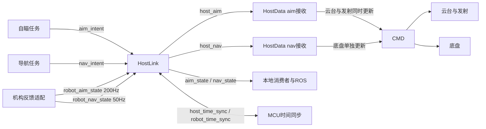
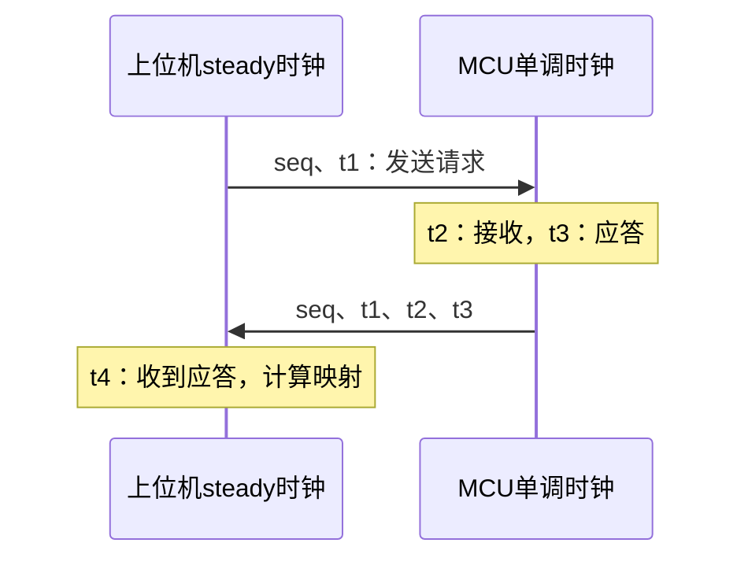
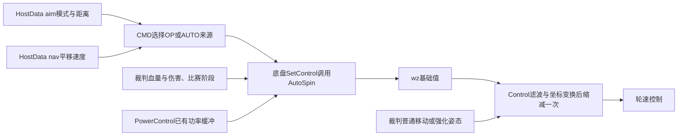

# 上下位机Topic通信

当前方案：自瞄与导航上下行均独立分包，共用第二路Host USB CDC。上位机采用C++20、LibXR与XRobot；通信、时钟对齐与ROS桥接统一在HostLink模块内，ROS适配按构建选项启用。

## 下行

| 包 | 字段 | 载荷 |
| --- | --- | --- |
| host_aim | target_time_mcu_us；yaw/yaw_vel/yaw_acc；pitch/pitch_vel/pitch_acc；distance、enemy_center_yaw；mode、fire_control、back_find、id、armors_num | 45 B |
| host_nav | vx、vy、big_yaw_angle；nav_state、navi_task、sentry_state | 15 B |

mode为0停止、1扫描、2自瞄。aim一次更新云台与发射；nav独立更新底盘。两路接收各自100ms超时，不互相续期。只运行视觉时仅发aim即可；不发送空导航包。上位机同样分别判断生产时间和接收时间，旧意图停止发送，由板端原有超时处理接管。

云台停止时联锁禁止导航和发射；扫描、自瞄允许导航。遥控仍控制全局OP/AUTO，wz不从上位机接入，AUTO由底盘本地策略生成，OP由遥控决定。下行速度为大Yaw系，单位m/s；角度rad，角速度rad/s，角加速度rad/s²。

当前生效字段为目标角及导数、mode、fire_control、distance、vx/vy。其余业务字段保留在aim或nav的接收包中，暂不额外缓存、不自动启用旧战术。没有host_metadata或host_command。

## 上行

| 包 | 字段 | 载荷 |
| --- | --- | --- |
| robot_aim_state | imu_time_us；quaternion[4]、gyro[3]、accel[3]；yaw、yaw_vel、pitch、pitch_vel；bullet_speed、heat、heat_limit、bullet_count、color | 79 B |
| robot_nav_state | vx、vy、wz、chassis_yaw、big_yaw_angle；stage_remain_time、current_hp、base_hp、our_outpost_hp；robot_id、color、game_progress；fortress_point_status、sentry_state、our_outpost_is_destroyed、enemy_outpost_is_destroyed | 35 B |

没有mode、sample_seq、boot_id、permit、有效性位图、功率、机械相对角或裁判来源时间。上行底盘速度为BODY系，big_yaw_angle为大Yaw惯性绝对角。四元数顺序wxyz。敌方前哨站摧毁状态当前缺少来源，值为默认0，尚不能用于战术判断。

IMU时间保留真实软件消费帧的MCU时刻；不是硬件曝光或硬件采样时刻。云台与IMU来自异步来源，目前并非严格同刻快照。导航没有采样时间字段，ROS导航header使用上位机接收时刻。

## 时间同步

| 包 | 字段 | 载荷 |
| --- | --- | --- |
| host_time_sync | uint32 seq、uint64 t1_host_us | 12 B |
| robot_time_sync | uint32 seq、uint64 t1_host_us、uint64 t2_mcu_us、uint64 t3_mcu_us | 28 B |

时间统一为μs。偏移θ=[(t2−t1)+(t3−t4)]/2；RTT=(t4−t1)−(t3−t2)。先用8个样本估计偏移，再在至少30s跨度的低RTT样本上估计时钟漂移，映射为MCU_us≈a×host_steady_us+b。修正保持当前锚点连续，减少逐包估计抖动。启动请求10Hz，同步后1Hz，3s未更新则映射失效。时间同步不刷新控制输入。

USB重连或MCU姿态时间回退时清理旧意图与映射。无启动唯一标识时，未观察到时间回退的重启不能保证立即识别。软件时间戳包含队列和调度误差，对称时延假设也有偏差，真实精度需测量。

## 封装与集成

LibXR Topic帧额外17 B，payload采用小端固定宽度整数与IEEE754 float32。串口一次只提交一个在途帧，aim/nav轮流获得发送机会。协议头为HostData/host_protocol.hpp；上位机工程已移到独立仓库`../host_connection/host`，内嵌协议头副本并由`tools/check_protocol.py`校验与下位机模块一致。上位机自持串口传输：100ms未完成即断连重开，断开不重放旧帧。

ROS桥接只转换本地Topic，不拥有USB。姿态同时提供MCU时间、换算steady时间和ROS时间；本地sync_valid表示换算是否就绪，不进入线上业务包。sp_vision的CBoard适配和相机时间域未在本次实现。

## 自动旋转的数据流

LOCAL自动源只在AUTO生效。静止自瞄远目标(距离>4m)不旋转，近目标−3.5rad/s；其余−2rad/s。
受击后−7rad/s，原车1s标志加5s延迟保持合计6s。准备/五秒倒计时覆盖为−1rad/s，自检或缓冲<30J覆盖为0。
普通移动姿态不缩减旋转；其余姿态按滤波及BODY变换后的|vx|+|vy|，从0.5到2m/s线性缩减至30%。
判定和速度参数放在机器人YAML的chassis.param.auto_spin。

受击沿用原车血量下降规则：战斗中伤害类型为0，非战斗阶段不限制伤害类型。裁判摘要不重复续期受击事件。
0x020D姿态取第二个16位的12～13位，强化标志取bit15；当前只消费前6字节，扩展报文尾部不进入旋转策略。

nav超时仅停止平移，仍可按有效aim进行本地旋转；aim超时、mode=0、遥控无力或机构失联仍通过云台联锁让底盘无力。
不恢复旧mode=5过坡分支，也不恢复原车离线后继续小陀螺的分支。
